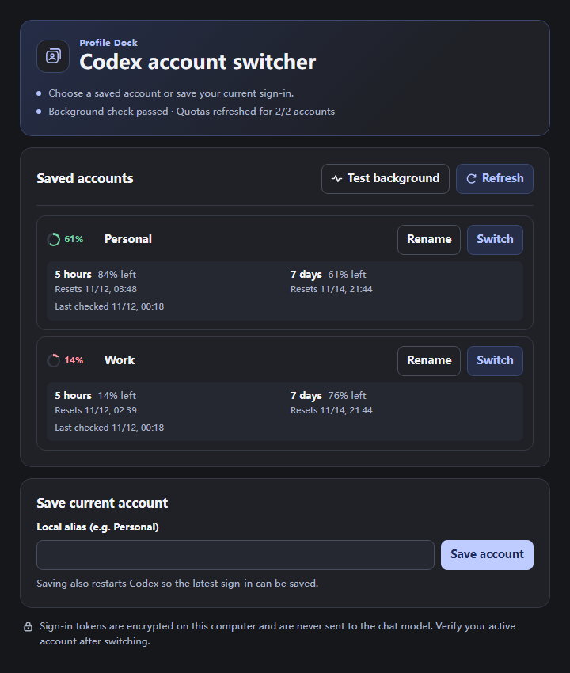

  <picture>
    <source media="(prefers-color-scheme: dark)" srcset="sidebar/plugins/sidebar/assets/profile-dock-dark.png">
    
  </picture>

<h1 align="center">Codex Profile Dock</h1>

Switch ChatGPT accounts and check remaining quota from the Codex sidebar.

  <a href="https://github.com/HELIXXr/CodexProfileDock/releases/latest"><strong>Download for Windows</strong></a>
  · <a href="https://github.com/HELIXXr/CodexProfileDock/releases/tag/v0.9.0-beta.1"><strong>Download macOS Beta</strong></a>
  · <a href="README.md">简体中文</a>
  · <a href="#installation">Installation</a>

  
   Screenshot uses demo accounts and quota data.

## Features

| Feature | What it does |
| --- | --- |
| **Save and switch** | Save your current sign-in under an alias. After you confirm a switch, Profile Dock asks Codex to quit, updates the local sign-in, and reopens Codex. |
| **Check quota** | See the remaining percentage and reset time for each quota window. The ring beside an account shows its lowest remaining percentage. |
| **Rename and display language** | Rename saved aliases in the sidebar. The panel uses Simplified Chinese for Chinese Codex locales and English for all other locales. |

## Installation

### Windows

On Windows, you need the **official Codex desktop app** (now part of ChatGPT Desktop), **Codex CLI**, and **Node.js 22 or later**.

Tested with the **x64 Microsoft Store installation**. Installs from the official web installer, `winget`, or offline MSIX are expected to work if Windows registers the `OpenAI.Codex` package and its Start menu entry is available. Offline MSIX and Arm64 have yet to be tested end to end. The sidebar requires the desktop app as its host. [OpenAI Windows deployment guide](https://learn.chatgpt.com/docs/enterprise/windows-deployment)

1. Install Codex Desktop and open it once. Install [Node.js](https://nodejs.org/en/download), then run `node --version` and `codex --version` in a new terminal. If `codex` is missing, run `npm install -g @openai/codex` and reopen the terminal.
2. Download `Codex-Profile-Dock-Windows-*.zip` from [GitHub Releases](https://github.com/HELIXXr/CodexProfileDock/releases/latest). Extract the entire ZIP to a folder you plan to keep.
3. Double-click `Install-Profile-Dock.cmd`. Save your work, fully quit and reopen Codex, then open **Profile Dock** from the sidebar. Select **Test background** to check the installation.

To upgrade, run the installer from the new release. To uninstall, run `Uninstall-Profile-Dock.cmd` and reopen Codex. Saved account records stay on your computer.

### macOS Beta

1. Install Codex Desktop, Codex CLI, Node.js 22 or later, and Apple Command Line Tools. If the tools are missing, run `xcode-select --install` in Terminal.
2. Download the [macOS Beta](https://github.com/HELIXXr/CodexProfileDock/releases/tag/v0.9.0-beta.1) and extract the entire ZIP. Run `sidebar/macos/Install-Profile-Dock.command`.
3. Set `cli_auth_credentials_store = "file"` at the top level of your Codex user config (`~/.codex/config.toml`). Fully quit and reopen Codex, sign in again if needed, then open **Profile Dock** from the sidebar.

Installation, uninstallation, Keychain access, and background startup passed on Apple Silicon and Intel macOS 15 runners. Switching real accounts in Codex Desktop still needs an end-to-end test on a Mac. [Full macOS guide](https://github.com/HELIXXr/CodexProfileDock/blob/v0.9.0-beta.1/README.macOS.md) · [Test results](https://github.com/HELIXXr/CodexProfileDock/actions/runs/43135015083)

## Save and switch accounts

1. Sign in to your first account normally in Codex. In Profile Dock, enter an alias such as `Personal`, select **Save account**, and confirm.
2. Sign in to your second account normally and save it under a different alias, such as `Work`.
3. Before switching, save your work and wait for running tasks to finish. Select **Switch** next to the target account and confirm. Verify the active account after Codex reopens. Select **Refresh** to fetch the latest quota.

## Compatibility and account data

- Switching requires Codex to store its active ChatGPT sign-in in `auth.json`. It is unavailable when Codex uses the system credential store for its active sign-in or when you sign in with an API key. Codex manages conversation data separately.
- On Windows, DPAPI encrypts saved sign-ins under `%LOCALAPPDATA%\CodexProfileDock` or an existing `LocalCodexSwitch` folder. On macOS, saved sign-ins use the system Keychain. Keep `auth.json`, `.dpapi` files, and private backups to yourself.
- Codex App Server requests quotas from OpenAI. The sidebar receives quota data only.

[Full Windows setup and troubleshooting guide](sidebar/README.en.md)

Unofficial project. Not affiliated with OpenAI.
