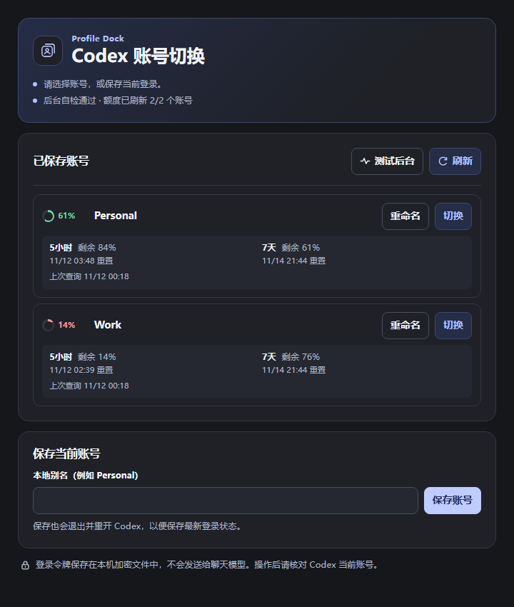

  <picture>
    <source media="(prefers-color-scheme: dark)" srcset="sidebar/plugins/sidebar/assets/profile-dock-dark.png">
    
  </picture>

<h1 align="center">Codex Profile Dock</h1>

从 Codex 侧栏切换 ChatGPT 账号，查看剩余额度和重置时间。

  <a href="https://github.com/HELIXXr/CodexProfileDock/releases/latest"><strong>下载 Windows 安装包</strong></a>
  · <a href="README.en.md">English</a>
  · <a href="#安装">安装指南</a>

  
   截图中的账号与额度均为示例。

## 功能

| 操作 | 说明 |
| --- | --- |
| **保存与切换** | 给当前登录保存一个别名。确认切换后，插件会请求 Codex 正常退出，更新本机登录状态，再重开 Codex。 |
| **查看额度** | 查看各账号的剩余百分比和重置时间。账号旁的圆环显示各额度窗口中最低的剩余百分比。 |
| **重命名与界面语言** | 在侧栏重命名已保存的账号。Codex 使用中文时显示简体中文，其余语言显示英文。 |

## 安装

需要 Windows 上的 **Microsoft Store 版 Codex 桌面应用**、**Codex CLI** 和 **Node.js 22 或更高版本**。

1. 安装并打开一次 Codex 桌面应用。安装 [Node.js](https://nodejs.org/en/download)，在新终端运行 `node --version` 和 `codex --version`。如果找不到 `codex`，运行 `npm install -g @openai/codex` 后重开终端。
2. 从 [GitHub Releases](https://github.com/HELIXXr/CodexProfileDock/releases/latest) 下载 `Codex-Profile-Dock-Windows-*.zip`，完整解压到准备保留的文件夹。
3. 双击 `Install-Profile-Dock.cmd`。保存工作，完全退出并重开 Codex，再从侧栏打开 **Profile Dock**。可用「测试后台」检查安装。

升级时运行新版安装脚本即可。卸载时双击 `Uninstall-Profile-Dock.cmd`，然后重开 Codex。已保存的账号记录保留在本机。

## 保存和切换账号

1. 在 Codex 正常登录第一个账号。在 Profile Dock 输入别名，例如 `Personal`，点击「保存账号」并确认。
2. 在 Codex 正常登录第二个账号，用另一个别名，例如 `Work`，保存一次。
3. 切换前先保存工作，等待运行中的任务结束。在目标账号旁点击「切换」并确认。Codex 重开后核对当前账号。用「刷新」查询最新额度。

## 兼容性和账号数据

- 支持 Codex 将 ChatGPT 登录保存到 `auth.json` 的方式。使用系统凭据库或 API Key 登录时无法保存账号。聊天数据由 Codex 管理。
- 账号记录使用 Windows DPAPI 加密，存放在 `%LOCALAPPDATA%\CodexProfileDock`，或沿用旧版 `LocalCodexSwitch` 目录。请妥善保管 `auth.json`、`.dpapi` 文件和私人备份。
- 额度由 Codex App Server 向 OpenAI 查询。侧栏只接收额度数据。

[完整安装与故障排查](sidebar/README.md) · [旧版独立窗口说明](docs/standalone.zh-CN.md)

非官方项目，与 OpenAI 无隶属关系。
